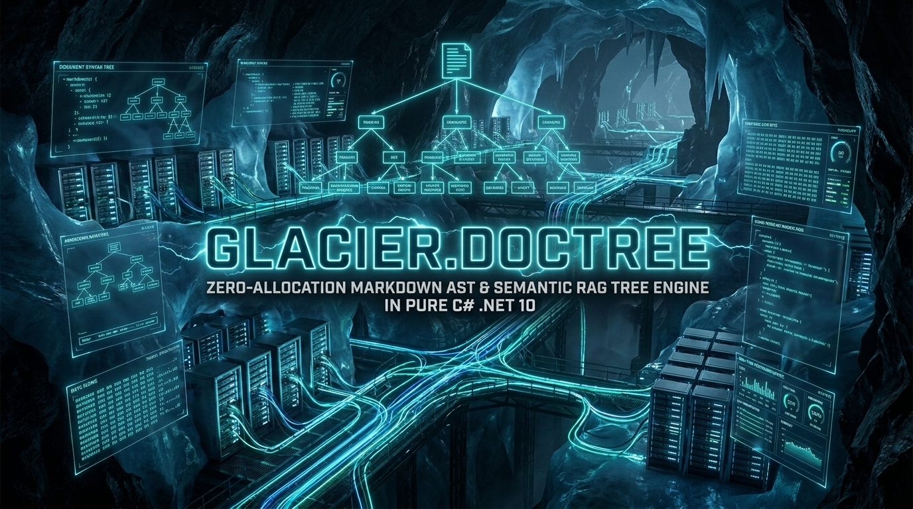
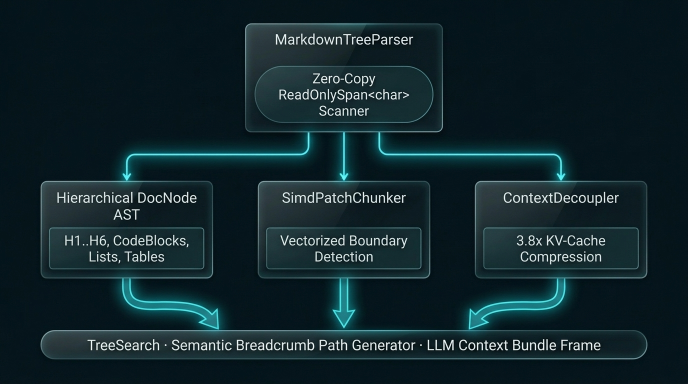

# Glacier.DocTree

[](LICENSE)
[](https://dotnet.microsoft.com/)
[](https://learn.microsoft.com/dotnet/core/deploying/native-aot/)
[](https://www.nuget.org/packages/Glacier.DocTree/)
[](https://www.nuget.org/packages/Glacier.DocTree/)
[](https://github.com/ian-cowley)
[](https://dev.to/iancowley/why-naive-rag-is-dead-i-built-a-zero-dependency-c-semantic-tree-parser-2ph8)
[](https://glaciersoftware.dev/)
[](https://buymeacoffee.com/glaciersoftware)

> 📖 **Original v1.0 Deep-Dive**: **[Why naive RAG is dead: I built a zero-dependency C# semantic tree parser.](https://dev.to/iancowley/why-naive-rag-is-dead-i-built-a-zero-dependency-c-semantic-tree-parser-2ph8)** *(Note: since v1.2+, `Glacier.DocTree` depends on `Glacier.Polaris`, `Glacier.Graph`, and `System.IO.Hashing` for columnar decoupling, CSR graph extraction, and hardware-accelerated CRC-32.)*


**Glacier.DocTree** is a high-performance Markdown parser, structural chunking engine, and unified `.gdoc` v2 binary document AST library for .NET 10. Built explicitly for Retrieval-Augmented Generation (RAG), AI search context indexing, and semantic document analysis, it parses flat Markdown text into a nested, structural **Document Object Tree** (`DocNode`) and integrates with `Glacier.Polaris`, `Glacier.Graph`, and `System.IO.Hashing`.

Unlike flat sliding-window text splitters, Glacier.DocTree maintains the structural parent-child relationships between headers (`H1` to `H6`), paragraphs, fenced code blocks, and lists. This ensures LLMs are supplied with complete section context, header breadcrumbs, and intact semantic blocks.

<p align="center">
  
</p>

---

## Key Features

*   📂 **Hierarchical Markdown Parser (`SpanMarkdownParser` / `MarkdownTreeParser`)**: Transforms raw Markdown text into a structural tree of `DocNode` elements (`Root`, `Header1`–`Header6`, `Paragraph`, `CodeBlock`, `List`). Markdown tables and inline links are extracted by `ColumnarContextDecoupler.DecoupleMarkdownTable` and `GraphContextDecoupler.ExtractDocumentGraph` respectively; `GDocNodeType` defines additional AST enum slots (`Table`, `ListItem`, `Bold`, `Italic`, `Link`, `Text`) for binary AST tooling.
*   🧭 **Semantic Path Generation**: Walks a node upward iteratively (with cycle protection) to generate semantic breadcrumbs (e.g. `Document Root > API Manual > Security > OAuth2.0`).
*   🧠 **LLM Context Bundles**: Extracts a target document section and packages it into a formatted RAG frame including header paths and all descendant text gathered iteratively.
*   🔍 **Iterative Tree Traversals (`TreeSearch`)**: Fast header lookup and content-node keyword search using pooled scratch stacks (no call-stack recursion).
*   ⚡ **Native AOT & Unified `.gdoc` v2 Persistence**: Built with `IsAotCompatible` and source-generated `DocTreeJsonContext` for safe incremental lazy JSON tree persistence (`TreeSerializer`), alongside the unified memory-mapped `.gdoc` v2 binary format (`0x434F4447` `"GDOC"` LE, 64-byte header, 48-byte AST nodes with `uint` text/span lengths, native `GdocMetadataEntry` table, optional vectors/token spans, hardware IEEE 802.3 CRC-32 payload integrity via `System.IO.Hashing.Crc32`, and backward compatibility with legacy v1 files).
*   🧩 **SIMD Byte-Patch Boundary Chunking (`SimdDocTreePatchChunker`)**: Vectorized (`Vector512` / `Vector256` / `Vector128` + scalar fallback) structural boundary detection on code, Markdown, and JSON UTF-8 byte streams with zero-allocation `ChunkUtf8` and `CountPatches` APIs.
*   📊 **Columnar & Graph Context Decoupling (`ColumnarContextDecoupler`, `GraphContextDecoupler`)**: Extracts Markdown tables and telemetry into Apache Arrow-aligned `Glacier.Polaris.DataFrame` memory blocks, and extracts section hierarchies (`CONTAINS`) plus inline Markdown/wiki links (`LINKS_TO`) into `Glacier.Graph` Forward Star / memory-mapped CSR stores.

## Dependencies

* `Glacier.Polaris` (1.2.6) — Arrow-aligned `DataFrame` / typed column storage
* `Glacier.Graph` (1.2.1) — Forward Star `GraphStore` and memory-mapped `CsrGraphStore`
* `System.IO.Hashing` (10.0.13) — Hardware-accelerated IEEE 802.3 `Crc32`

---

## Installation

Glacier.DocTree is available as a [NuGet package](https://www.nuget.org/packages/Glacier.DocTree). Install it using the .NET CLI:

```bash
dotnet add package Glacier.DocTree
```

---

## Quick Start

### 1. Parse a Markdown Document

Initialize `MarkdownTreeParser` (or call `SpanMarkdownParser.Parse` directly) to turn raw Markdown into a hierarchical tree:

```csharp
using Glacier.DocTree.Core;
using Glacier.DocTree.Traversal;

string markdown = @"
# API Documentation
This is the root API description.

## Authentication
To authenticate, you must use an API key.

### Header Validation
Provide the API key in the `X-API-Key` header:
```bash
curl -H 'X-API-Key: secret_key' https://api.example.com/v1/data
```
";

var parser = new MarkdownTreeParser();
DocNode treeRoot = parser.Parse(markdown);
```

### 2. Traverse and Query Sections

Use `TreeSearch` to find specific headings or filter sections:

```csharp
var search = new TreeSearch(treeRoot);

// Find a specific section header
DocNode? authSection = search.FindHeader("Authentication");
if (authSection != null)
{
    Console.WriteLine($"Found Heading: {authSection.Content} (Type: {authSection.Type})");
}
```

### 3. Generate Semantic Breadcrumbs

Track the parent hierarchy path of any node:

```csharp
DocNode? headerValidation = search.FindHeader("Header Validation");
if (headerValidation != null)
{
    string path = TreeSearch.GetSemanticPath(headerValidation);
    Console.WriteLine($"Semantic Path: {path}");
    // Output: Document Root > API Documentation > Authentication > Header Validation
}
```

### 4. Create RAG Context Bundles

Extract a clean, fully contextualized text bundle to feed directly to an LLM prompt:

```csharp
string contextBundle = search.GetLlmContextBundle("Header Validation");
Console.WriteLine(contextBundle);

/*
Output:
--- SEMANTIC CONTEXT ---
LOCATION: Document Root > API Documentation > Authentication > Header Validation
--- BEGIN TEXT ---
Header Validation
Provide the API key in the `X-API-Key` header:
```bash
curl -H 'X-API-Key: secret_key' https://api.example.com/v1/data
```
--- END TEXT ---
*/
```

---

## Interactive Demo Output

When running the bundled demo project (`samples/Glacier.DocTree.Demo`), you will see the hierarchical tree visualization and RAG query context extraction in action:

```text
==========================================
 Glacier.DocTree | Semantic Parser Engine
==========================================

[1] Parsing Markdown into Semantic Tree...

[2] Visualizing the Document Structure:
└─ [Root] Document Root
  └─ [Header1] Glacier Enterprise API
    └─ [Paragraph] Welcome to the Glacier API. This docu...
    └─ [Header2] Authentication
      └─ [Paragraph] All requests to the API must be crypt...
      └─ [Header3] OAuth 2.0
        └─ [Paragraph] To authenticate via OAuth2, you must ...
        └─ [CodeBlock] ```json {   "Authorization": "Bearer ...
    └─ [Header2] Usage Policies
      └─ [Paragraph] Please adhere to the following usage ...
      └─ [Header3] Rate Limits
        └─ [Paragraph] Free tier users are limited to 100 re...
      └─ [Header3] Acceptable Use
        └─ [Paragraph] Do not use the API to train competing...

[3] Simulating Agent Query: 'Extract Rate Limits context'

--- SEMANTIC CONTEXT ---
LOCATION: Document Root > Glacier Enterprise API > Usage Policies > Rate Limits
--- BEGIN TEXT ---
Rate Limits
Free tier users are limited to 100 requests per minute.
Enterprise users have unlimited access.
If you exceed the limit, you will receive an HTTP 429 status code.
--- END TEXT ---

==========================================
 DOCTREE ENGINE READY FOR AGENT DEVKIT
==========================================
```

---

## Architecture Overview

1.  **Semantic Parser Strategy (`SpanMarkdownParser`)**: Walks text lines sequentially via `SpanLineEnumerator`, dynamically tracking open headers (`H1`–`H6`) using an active parent level array.
2.  **Block Transitions**: Handles transitions cleanly between headers, paragraphs, lists, and fenced code blocks (preserving code fence lines inside `CodeBlock.Content`).
3.  **Iterative Traversal**: Resolves full descendant text, tree searches, binary/JSON serialization, and graph extraction using pooled scratch stacks (`ValueDocNodeStack<T>`) with zero call-stack recursion.
4.  **Unified `.gdoc` v2 Binary Format**: Uses little-endian magic `0x434F4447` (`"GDOC"`), `Version = 2`, 64-byte header with hardware-accelerated IEEE 802.3 CRC-32 over the payload, 48-byte AST nodes (`uint` text/span lengths), optional token spans and float embeddings, and native `GdocMetadataEntry` storage — while remaining backward-readable for legacy v1 `.gdoc` files.

---

## Contributing

We welcome community contributions! Please read [CONTRIBUTING.md](CONTRIBUTING.md) for local setups, branch models, and PR checklist details.

## 🆕 What's New in v1.3.1

- **Unified `.gdoc` v2 format & native metadata** — unified `GDocWriter`/`GDocReader` and `Binary.GdocWriter`/`GdocReader` onto version 2 (`0x434F4447`), widening `TextLength`/`TokenSpanIndex` to `uint`, adding native `GdocMetadataEntry` storage (eliminating synthetic JSON child nodes), atomic file replacement, and preserving legacy v1 read compatibility.
- **Hardened memory-mapped reading & streaming writes** — added atomic `Interlocked` disposal and `ObjectDisposedException` guards across all `GDocReader`/`Binary.GdocReader` accessors, safe MMF cleanup on open failure, single-pass `ArrayBufferWriter<byte>` string pooling, and relative-offset padding safe on non-seekable/non-zero-offset streams.
- **Iterative AST traversals & safe JSON updates** — eliminated recursive tree walks across `DocNode.GetFullText`, `TreeSearch`, `TreeSerializer`, `GraphContextDecoupler`, and `GlacierStorageDocExtensions`; keyed `GraphContextDecoupler` nodes by hierarchical path + structural index; stopped `TreeSerializer.Serialize` from deleting unrelated `*.json` files.
- **SIMD patch chunker & hardware CRC-32** — fixed short-segment pending delimiter flushing, added `Vector128` path and zero-allocation `CountPatches`, added identifier word-boundary checks in `StartsWithKeyword`, and switched `GdocCrc32` to hardware-accelerated `System.IO.Hashing.Crc32`.

## Credits

Developed by **Ian Cowley** and **Antigravity (Google DeepMind)**.

## License

This project is licensed under the MIT License - see the [LICENSE](LICENSE) file for details.

---

## ❄️ Glacier Ecosystem & Support

Part of the **[Glacier Ecosystem](https://glaciersoftware.dev/)** — high-performance, low-allocation developer tooling and data engines natively built for modern C# and .NET 10.

* 🌐 **Website & Documentation**: [glaciersoftware.dev](https://glaciersoftware.dev/)
* ☕ **Buy Me a Coffee**: [buymeacoffee.com/glaciersoftware](https://buymeacoffee.com/glaciersoftware)
* ❤️ **GitHub Sponsors**: [github.com/sponsors/ian-cowley](https://github.com/sponsors/ian-cowley)
* 🐙 **All Repositories**: [github.com/ian-cowley](https://github.com/ian-cowley)
