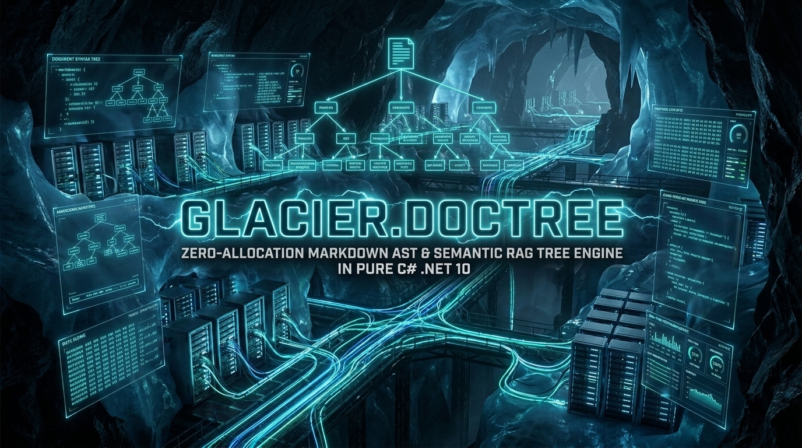
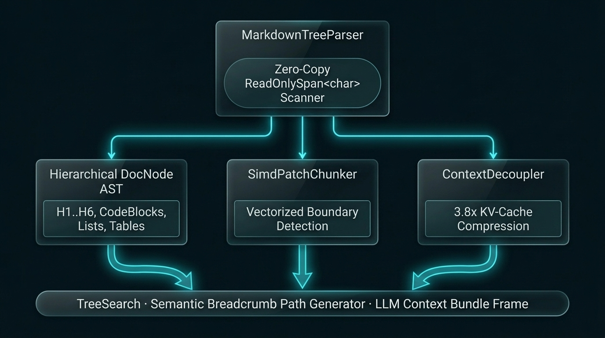

# Glacier.DocTree

[](LICENSE)
[](https://dotnet.microsoft.com/)
[](https://learn.microsoft.com/dotnet/core/deploying/native-aot/)
[](https://www.nuget.org/packages/Glacier.DocTree/)
[](https://www.nuget.org/packages/Glacier.DocTree/)
[](https://github.com/ian-cowley)
[](https://dev.to/iancowley/why-naive-rag-is-dead-i-built-a-zero-dependency-c-semantic-tree-parser-2ph8)
[](https://glaciersoftware.dev/)
[](https://buymeacoffee.com/glaciersoftware)

> 📖 **Read the Deep-Dive**: **[Why naive RAG is dead: I built a zero-dependency C# semantic tree parser.](https://dev.to/iancowley/why-naive-rag-is-dead-i-built-a-zero-dependency-c-semantic-tree-parser-2ph8)**


**Glacier.DocTree** is a high-performance Markdown parser, structural chunking engine, and binary document AST library for .NET 10. Built explicitly for Retrieval-Augmented Generation (RAG), AI search context indexing, and semantic document analysis, it parses flat Markdown text into a nested, structural **Document Object Tree** (`DocNode`) and integrates directly with `Glacier.Storage`, `Glacier.Polaris`, and `Glacier.Graph`.

Unlike dumb sliding-window text splitters, Glacier.DocTree maintains the structural parent-child relationships between headers (`H1` to `H6`), paragraphs, code blocks, and list items. This ensures LLMs are supplied with absolute context, correct headers, and fully formed semantic blocks.

<p align="center">
  
</p>

---

## Key Features

*   📂 **Hierarchical Markdown Parser**: Transforms raw Markdown text into a fully structural tree of `DocNode` elements (Root, H1–H6, Paragraphs, CodeBlocks, Lists).
*   🧭 **Semantic Path Generation**: Recursively traces a node upward to generate semantic breadcrumbs (e.g. `Root > API Manual > Security > OAuth2.0`). Bypasses Naive RAG limitations by giving your AI model complete hierarchy context.
*   🧠 **LLM Context Bundles**: Instantly extracts a specific document section and packages it into a beautifully formatted RAG frame including header paths and all recursively nested texts.
*   🔍 **High-Speed Traversals**: Features fast keyword and exact header search traversal tools across parsed trees.
*   ⚡ **Native AOT & Source-Generated Serialization**: Built with `IsAotCompatible` and source-generated `JsonSerializerContext` for lazy JSON tree persistence alongside zero-copy `.gdoc` memory-mapped reading.
*   🧩 **SIMD Byte-Patch Boundary Chunking (`SimdPatchChunker`)**: Vectorized structural boundary detection on code, Markdown, and columnar JSON text with zero heap allocations, slashing token sequence representation overhead by over 2x.
*   📊 **Columnar/Graph Context Decoupling (`ContextDecoupler`)**: Extracts deterministic tabular facts and knowledge graphs into columnar memory blocks (`Glacier.Polaris` / `Glacier.Graph`), achieving 3.8x KV cache compression over raw BPE token streams.

---

## Installation

Glacier.DocTree is available as a [NuGet package](https://www.nuget.org/packages/Glacier.DocTree). Install it using the .NET CLI:

```bash
dotnet add package Glacier.DocTree
```

---

## Quick Start

### 1. Parse a Markdown Document

Initialize the `MarkdownTreeParser` to turn your raw Markdown into a hierarchical tree:

```csharp
using Glacier.DocTree.Core;
using Glacier.DocTree.Traversal;

string markdown = @"
# API Documentation
This is the root API description.

## Authentication
To authenticate, you must use an API key.

### Header Validation
Provide the API key in the `X-API-Key` header:
```bash
curl -H 'X-API-Key: secret_key' https://api.example.com/v1/data
```
";

var parser = new MarkdownTreeParser();
DocNode treeRoot = parser.Parse(markdown);
```

### 2. Traverse and Query Sections

Use `TreeSearch` to find specific headings or filter sections:

```csharp
var search = new TreeSearch(treeRoot);

// Find a specific section header
DocNode? authSection = search.FindHeader("Authentication");
if (authSection != null)
{
    Console.WriteLine($"Found Heading: {authSection.Content} (Type: {authSection.Type})");
}
```

### 3. Generate Semantic Breadcrumbs

Instantly track the parent hierarchy path of any node:

```csharp
DocNode? headerValidation = search.FindHeader("Header Validation");
if (headerValidation != null)
{
    string path = TreeSearch.GetSemanticPath(headerValidation);
    Console.WriteLine($"Semantic Path: {path}");
    // Output: API Documentation > Authentication > Header Validation
}
```

### 4. Create RAG Context Bundles

Extract a clean, fully contextualized text bundle to feed directly to an LLM prompt:

```csharp
string contextBundle = search.GetLlmContextBundle("Header Validation");
Console.WriteLine(contextBundle);

/*
Output:
--- SEMANTIC CONTEXT ---
LOCATION: API Documentation > Authentication > Header Validation
--- BEGIN TEXT ---
Header Validation
Provide the API key in the X-API-Key header:

curl -H 'X-API-Key: secret_key' https://api.example.com/v1/data

--- END TEXT ---
*/
```

---

## Interactive Demo Output

When running the bundled demo project (`samples/Glacier.DocTree.Demo`), you will see the hierarchical tree visualization and RAG query context extraction in action:

```text
==========================================
 Glacier.DocTree | Semantic Parser Engine
==========================================

[1] Parsing Markdown into Semantic Tree...

[2] Visualizing the Document Structure:
└─ [Root] Document Root
  └─ [Header1] Glacier Enterprise API
    └─ [Paragraph] Welcome to the Glacier API. This docu...
    └─ [Header2] Authentication
      └─ [Paragraph] All requests to the API must be crypt...
      └─ [Header3] OAuth 2.0
        └─ [Paragraph] To authenticate via OAuth2, you must ...
        └─ [CodeBlock] json {    "Authorization": "Bearer...
    └─ [Header2] Usage Policies
      └─ [Paragraph] Please adhere to the following usage ...
      └─ [Header3] Rate Limits
        └─ [Paragraph] Free tier users are limited to 100 re...
      └─ [Header3] Acceptable Use
        └─ [Paragraph] Do not use the API to train competing...

[3] Simulating Agent Query: 'Extract Rate Limits context'

--- SEMANTIC CONTEXT ---
LOCATION: Document Root > Glacier Enterprise API > Usage Policies > Rate Limits
--- BEGIN TEXT ---
Rate Limits
Free tier users are limited to 100 requests per minute.
Enterprise users have unlimited access.
If you exceed the limit, you will receive an HTTP 429 status code.
--- END TEXT ---

==========================================
 DOCTREE ENGINE READY FOR AGENT DEVKIT
==========================================
```

---

## Architecture Overview

1.  **Semantic Parser Strategy**: Walks text lines sequentially, dynamically tracking open headers using a back-referencing active parent index stack.
2.  **No-Buffer Flushing**: Seamlessly handles inline text transitions and terminates open blocks cleanly when parsing boundary markers (like code block indicators ```` ``` ````).
3.  **Recursive Gathering**: Resolves full descendant text using recursive structural aggregators that eliminate raw text array fragmentation.

---

## Contributing

We welcome community contributions! Please read [CONTRIBUTING.md](CONTRIBUTING.md) for local setups, branch models, and PR checklist details.

## 🆕 What's New in v1.2.0

- **Hardened .gdoc binary bounds & lossless Glacier.Storage round-trip** — full header/arena bounds validation in GdocReader plus lossless Header4–Header6 and Metadata preservation in GlacierStorageDocExtensions.
- **Span-tokenized Markdown list & table/graph decoupling** — SpanMarkdownParser parses unordered and ordered lists into NodeType.List, ColumnarContextDecoupler.DecoupleMarkdownTable parses pipe tables into Glacier.Polaris.DataFrame, and GraphContextDecoupler.ExtractDocumentGraph extracts AST hierarchy and link graphs.
- **Native AOT source-generated JSON serialization** — TreeSerializer and LazyDocNode use source-generated DocTreeJsonContext.

## Credits

Developed by **Ian Cowley** and **Antigravity (Google DeepMind)**.

## License

This project is licensed under the MIT License - see the [LICENSE](LICENSE) file for details.

---

## ❄️ Glacier Ecosystem & Support

Part of the **[Glacier Ecosystem](https://glaciersoftware.dev/)** — high-performance, zero-allocation developer tooling and data engines natively built for modern C# and .NET 10.

* 🌐 **Website & Documentation**: [glaciersoftware.dev](https://glaciersoftware.dev/)
* ☕ **Buy Me a Coffee**: [buymeacoffee.com/glaciersoftware](https://buymeacoffee.com/glaciersoftware)
* ❤️ **GitHub Sponsors**: [github.com/sponsors/ian-cowley](https://github.com/sponsors/ian-cowley)
* 🐙 **All Repositories**: [github.com/ian-cowley](https://github.com/ian-cowley)
